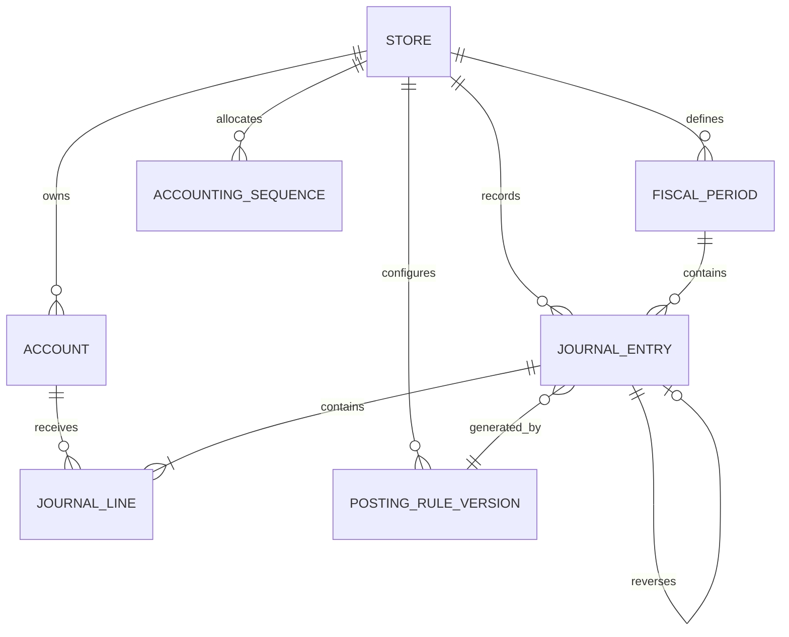

# Accounting Kernel — Relational Data Model

**Status:** Logical model for review before Prisma migrations  
**Database:** PostgreSQL  
**Initial ledger currency:** IRR

This document defines the logical entities and constraints. It is not yet an executable migration. Identity and tenant table names must be aligned with M2 before implementation.

## 1. Entity map

## 2. Tables and essential fields

### accounts

- id UUID primary key
- store_id UUID not null
- code VARCHAR(32) not null
- name_key VARCHAR(120) not null
- account_type enum: ASSET, LIABILITY, EQUITY, REVENUE, EXPENSE
- normal_balance enum: DEBIT, CREDIT
- parent_account_id UUID nullable
- is_postable BOOLEAN not null
- status enum: ACTIVE, INACTIVE
- created_at, updated_at timestamptz
- unique(store_id, code)
- composite FK ensures parent belongs to same store

### fiscal_periods

- id UUID primary key
- store_id UUID not null
- name VARCHAR(80) not null
- start_date DATE not null
- end_date DATE not null
- status enum: OPEN, CLOSING, CLOSED
- closed_at, closed_by nullable
- reopened_at, reopened_by nullable
- close_reason nullable
- CHECK(start_date <= end_date)
- no overlapping periods per store (exclusion constraint or transactional validation)

### posting_rule_versions

- id UUID primary key
- store_id UUID nullable for reviewed global templates
- rule_key VARCHAR(100) not null
- version VARCHAR(40) not null
- effective_from DATE not null
- effective_to DATE nullable
- configuration JSONB not null
- source_reference TEXT nullable
- approved_by UUID nullable
- approved_at timestamptz nullable
- status enum: DRAFT, APPROVED, RETIRED
- unique(scope, rule_key, version)
- Rule configuration must be schema-validated; JSONB is not a substitute for typed validation.

### journal_entries

- id UUID primary key
- store_id UUID not null
- period_id UUID not null
- entry_number BIGINT not null (unique within store and sequence policy)
- entry_date DATE not null
- currency_code CHAR(3) not null default 'IRR'
- status enum: DRAFT, POSTED
- source_type VARCHAR(50) not null
- source_id UUID nullable only for manual journal
- posting_purpose VARCHAR(50) not null
- posting_rule_version_id UUID nullable for manual entries
- idempotency_key VARCHAR(128) not null
- reverses_entry_id UUID nullable
- description TEXT nullable
- created_by UUID not null
- posted_by UUID nullable
- created_at, posted_at timestamptz
- request_id UUID nullable
- unique(store_id, entry_number)
- unique(store_id, source_type, source_id, posting_purpose) where source_id is not null
- unique(store_id, idempotency_key)
- unique(reverses_entry_id) for one full reversal
- composite FKs enforce period and source same store

### journal_lines

- id UUID primary key
- store_id UUID not null (denormalized for composite FK enforcement)
- journal_entry_id UUID not null
- line_number SMALLINT not null
- account_id UUID not null
- description TEXT nullable
- debit_irr BIGINT not null default 0
- credit_irr BIGINT not null default 0
- dimensions JSONB nullable only for non-critical reporting dimensions; core dimensions should be typed
- unique(journal_entry_id, line_number)
- CHECK(debit_irr >= 0 AND credit_irr >= 0)
- CHECK((debit_irr > 0 AND credit_irr = 0) OR (credit_irr > 0 AND debit_irr = 0))
- composite FKs ensure account and journal belong to same store

### accounting_sequences

- store_id UUID primary key
- next_entry_number BIGINT not null CHECK(next_entry_number > 0)
- updated_at timestamptz not null
- Updated with row lock inside the posting transaction. Never use MAX(entry_number)+1.

### accounting_audit_events

- id UUID primary key
- store_id UUID not null
- actor_id UUID nullable for system worker
- event_type VARCHAR(80) not null
- entity_type VARCHAR(50) not null
- entity_id UUID not null
- reason TEXT nullable
- metadata JSONB not null
- command_id UUID not null
- occurred_at timestamptz not null
- append-only; avoid copying secrets or unnecessary personal data.

## 3. Constraints requiring transaction/deferred enforcement

A row CHECK cannot verify the sum of all lines in a journal. On posting:

- Lock journal header.
- Verify at least two lines.
- Verify all lines are valid and same-store.
- Sum debit and credit using exact integer arithmetic.
- Require equality and non-zero total.
- Require open period.
- Set status POSTED and posted metadata.
- Commit all in one transaction.

Use a deferred constraint trigger or a tightly controlled posting function as a second database-level guard. Prevent application DB role from updating/deleting posted header/lines. Add triggers to reject mutation once posted. Test trigger behavior through the real PostgreSQL integration suite.

## 4. Required indexes

- journal_entries(store_id, entry_date, entry_number)
- journal_entries(store_id, period_id, status)
- journal_lines(store_id, account_id, journal_entry_id)
- journal_lines(journal_entry_id, line_number)
- accounts(store_id, parent_account_id, status)
- fiscal_periods(store_id, start_date, end_date)
- accounting_audit_events(store_id, entity_type, entity_id, occurred_at)

Use partial indexes for posted records and source idempotency where supported. Validate query plans against representative data volume.

## 5. Referential integrity rules

- Every journal line account belongs to the same store as its journal.
- Every journal period belongs to the same store as its journal.
- A reversal target belongs to the same store and currency.
- A reversal journal must contain the exact opposite lines of the original full journal, subject to line mapping and deterministic ordering.
- Source document and journal references are unique per posting purpose.
- Deleting a store/account/period/journal with posted financial history is prohibited.
- Historical display names should be snapshotted on the journal line if account labels may change; stable account IDs remain authoritative.

## 6. Sequence and concurrency

Use a per-store sequence row:

1. Lock sequence row with SELECT FOR UPDATE.
2. Read and increment next_entry_number.
3. Insert journal and lines.
4. Commit all changes together.

A rollback must not create an inconsistent duplicate. Gaps may exist only if the business explicitly accepts them; if gapless numbering is a legal requirement, obtain legal/accounting review and design a serialized numbering mechanism. Do not assume gapless numbers are required.

## 7. Open implementation questions

- M2 tenant/store schema and composite key conventions.
- Whether account code uniqueness is lifetime or version-scoped.
- Whether journals can be posted only by API procedure or through app transaction plus trigger.
- Required journal numbering policy.
- Required dimensions (cost center, project, terminal, cashier).
- Retention and immutability policy under applicable law.
- Fiscal calendar and close workflow.
