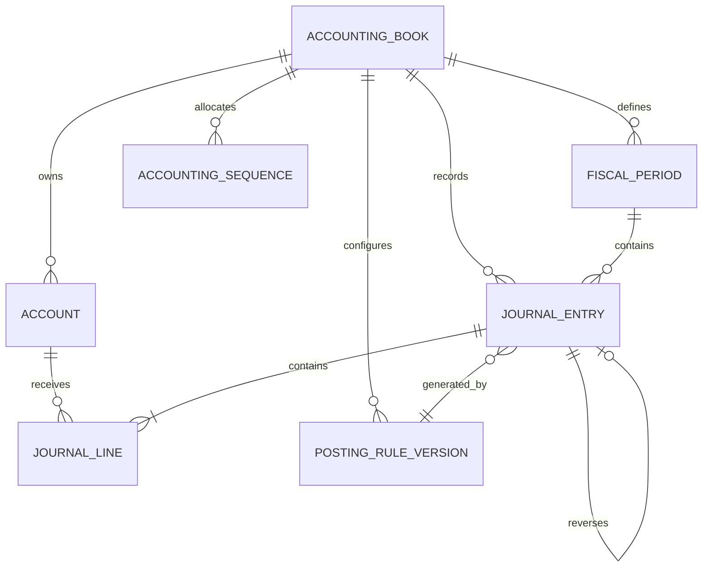

# Accounting Kernel — Relational Data Model

**Status:** Logical specification aligned with migration `0009_accounting_schema.sql`; schema foundation is implemented in the open M3 PR. Posting commands and read models are not implemented yet.  
**Database:** PostgreSQL  
**Initial ledger currency:** integer IRR

## 1. Scope and tenant/accounting-book boundary

Every accounting table carries both `tenant_id` and `accounting_book_id`. Composite foreign keys bind accounts, periods, posting rules, journal entries, lines, sequences, and audit events to the same tenant and store. RLS uses the M2 transaction-local tenant context.

The first migration uses accounting-book-scoped posting-rule versions. Global templates are deferred until a reviewed template workflow exists. No chart-of-accounts template or fiscal calendar is seeded.

## 2. Entity map

An accounting book is the ledger boundary. A tenant can own one or more books. Multiple stores or business locations can use one book. A book does not require a store.

## 3. Tables and essential constraints

### accounts

- Stable UUID, tenant_id, accounting_book_id.
- Code (32 chars), name_key (120 chars), account_type, normal_balance.
- Optional parent_account_id; composite FK keeps parent in the same accounting book.
- Parent/group accounts must be active and non-postable while they have children; a parent with children cannot be deactivated. Hierarchy cycles are rejected.
- is_postable, status (ACTIVE/INACTIVE), created_by_user_id, timestamps.
- Unique code within tenant/accounting-book.
- Used account classification (account_type and normal_balance) cannot change after a posted journal references it.
- Journal lines snapshot account code, name key, type, and normal balance.
- No universal Iran account-code template is seeded.

### fiscal_periods

- Stable UUID, tenant_id, accounting_book_id, name, start_date, end_date.
- Status: OPEN, CLOSING, CLOSED.
- Close and reopen metadata, including actor membership.
- Start date must be on or before end date.
- Periods cannot overlap within an accounting book. A transaction-scoped advisory lock serializes overlap checks.
- Posting must use an OPEN period and an entry date inside its boundaries. The deferred posting guard locks the period row so a close/reopen transaction can serialize against posting.
- Fiscal-year start and period length remain an accountant-approved decision.

### posting_rule_versions

- Stable UUID, tenant_id, accounting_book_id (required in the initial schema).
- rule_key, version, effective_from/effective_to, configuration JSONB, source_reference.
- Status: DRAFT, APPROVED, RETIRED; approval actor and timestamp are required for APPROVED/RETIRED.
- Unique tenant/accounting-book/rule/version.
- A rule is created as DRAFT. Only an approved rule can move to RETIRED. Approved configuration is immutable; a retired rule is immutable.
- Automated journals require an approved rule effective on the journal date. JSONB still requires typed application validation.

### journal_entries

- Stable UUID, tenant_id, accounting_book_id, period_id.
- entry_number is null while DRAFT and required when POSTED; numbering is accounting-book-scoped.
- entry_date, currency_code (IRR), status (DRAFT/POSTED).
- source_type, source_id (null only for MANUAL), posting_purpose, optional posting_rule_version_id for MANUAL.
- idempotency_key, optional reverses_entry_id, description, actor IDs, timestamps, request_id.
- Composite FKs bind period, rule version, reversal target, and actor memberships to the same tenant/accounting-book.
- Unique tenant/accounting-book/idempotency key; unique source event per posting purpose; one full reversal per original.
- Posted headers are immutable. Draft-to-posted transition is restricted to the accounting command owner.

### journal_lines

- Stable UUID, tenant_id, accounting_book_id, journal_entry_id, line_number, account_id.
- Snapshots: account_code, account_name_key, account_type, normal_balance.
- debit_irr and credit_irr are non-negative BIGINT values; exactly one side is positive.
- Optional description and dimensions JSONB.
- Composite FKs enforce same-book journal/account references.
- Lines of posted journals are immutable.
- Posting validates that snapshot fields match an active, postable account.

### accounting_sequences

- tenant_id, accounting_book_id primary key; next_entry_number > 0.
- Updated under a row lock inside the posting transaction.
- Never allocate numbers with MAX(entry_number)+1. Gapless numbering is not assumed.

### accounting_audit_events

- Stable UUID, tenant_id, accounting_book_id, actor membership (nullable for system worker).
- command_id, event_type, entity_type, entity_id, reason, metadata, occurred_at.
- Append-only trigger rejects update/delete.
- Unique command/event key prevents duplicate audit records for the same command event.
- Do not copy credentials, tokens, or unnecessary personal data into metadata.

## 4. Database posting guards

A deferred constraint trigger validates a journal when it transitions to POSTED:

- At least two lines and exact non-zero debit/credit equality.
- Every account is active and postable; snapshots match current account identity/classification.
- The posting date is inside an OPEN fiscal period.
- Automated source events use an approved effective posting rule.
- A reversal references a posted journal in the same accounting book/currency and exactly inverts its lines.
- A second full reversal of the same journal is rejected.

The database also rejects mutation of posted headers/lines, account reclassification after use, and mutation of approved posting-rule configuration.

## 5. Security and permissions

- RLS is enabled and forced on all accounting tables.
- `marketfa_app` has tenant-scoped SELECT only; it cannot write accounting rows directly.
- A dedicated non-login, non-superuser, non-BYPASSRLS `marketfa_accounting_owner` role owns the future command boundary and has tenant-scoped RLS policies.
- Posting API functions, idempotency behavior, source-document atomicity, period close/reopen commands, and audit command wiring are future implementation work.

## 6. Required indexes

- accounts(tenant_id, accounting_book_id, parent_account_id, status)
- fiscal_periods(tenant_id, accounting_book_id, start_date, end_date)
- journal_entries(tenant_id, accounting_book_id, entry_date, entry_number)
- journal_entries(tenant_id, accounting_book_id, period_id, status)
- journal_lines(tenant_id, accounting_book_id, account_id, journal_entry_id)
- journal_lines(tenant_id, accounting_book_id, journal_entry_id, line_number)
- accounting_audit_events(tenant_id, accounting_book_id, occurred_at)
- accounting_audit_events(tenant_id, accounting_book_id, entity_type, entity_id, occurred_at)

## 7. Remaining implementation questions

- Account-code uniqueness policy beyond the initial accounting-book-scoped unique constraint.
- Journal numbering policy and legal gapless-numbering requirements.
- Required dimensions (cost center, project, terminal, cashier).
- Maker/checker thresholds and manual journal permissions.
- Fiscal calendar and close/reopen workflow.
- Source-document tables and transactional posting ports for sales, purchases, returns, and settlements.
- Retention and immutability policy under applicable law.
